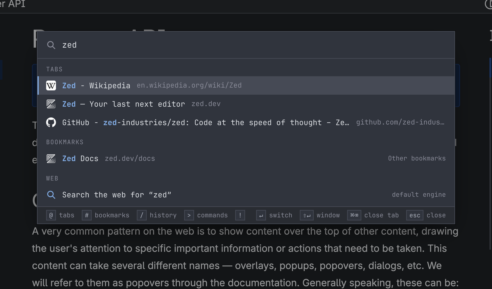

# Zelium

[](https://github.com/lulinretrograde/zelium/actions/workflows/ci.yml)

A Zed-style command palette for [Helium](https://helium.computer) and every other Chromium browser, on macOS, Windows, Linux and ChromeOS.
Press **⌘K** (macOS) or **Alt+K** (Windows/Linux/ChromeOS) and a sharp, dark palette opens in the middle of the screen. From one input you can search
your open tabs, bookmarks, history and recently closed tabs, run browser commands, do quick maths or
search the web.



## Features

- **One box for everything.** Results are grouped as *Tabs → Bookmarks → History → Commands → Web*,
  using fuzzy matching with highlighted characters, like Zed's file finder.
- **Prefix modes** narrow the search:

  | Prefix | Mode |
  | --- | --- |
  | `@` | open tabs |
  | `#` | bookmarks |
  | `/` | history |
  | `>` | commands |

  <kbd>Tab</kbd> / <kbd>⇧Tab</kbd> cycles between modes. <kbd>⌫</kbd> on an empty input goes back to *all*.
- **Bangs, the same ones Helium has:** 10,700+ sites (13,400 triggers) from the list Helium uses
  natively (Kagi's bangs plus Helium's extras). They work anywhere in the query, as a prefix or a
  suffix: `!w zed`, `serde !crates`, `!gh helium`, `!yt lofi`, `!chatgpt …`.
  - Type `!` for popular bangs, or `!gh` for every trigger starting with "gh". <kbd>↵</kbd> or <kbd>Tab</kbd> picks one.
  - A bang with no query (`!w` then <kbd>↵</kbd>) opens the site itself.
  - AI bangs are labelled. The list ships with the extension and loads the first time you type `!`,
    so there are no network requests. Run `npm run bangs` to refresh it.
- **Ask an AI:** type `claude: <message>`, `gpt: <message>`, `gemini: …`, `deepseek: …` or `kimi: …`
  and press <kbd>↵</kbd> (in `>` mode the colon is optional; without it, the main search just searches). Zelium opens a new chat, types the message in and sends it. Or pick
  *New Claude Chat* (etc.) and press <kbd>Tab</kbd> to write the message. You need to be signed in to
  the service; if Zelium can't find the message box (a sign-in page, or the site changed its layout), the new chat just stays open.
- **Calculator:** `2*(3+4)`, `sqrt(2)^2`, `2*pi`. <kbd>↵</kbd> copies the result.
- **Direct URLs:** `github.com`, `localhost:3000`, `192.168.1.1` open straight away.
- **Web search** goes through **your browser's default search engine**.
- **Commands (`>`):**
  - copy URL, copy title, copy as a Markdown link; copy every tab in the window as URLs or a Markdown list
  - new, close, duplicate, pin or mute a tab; close other tabs, tabs to the right, or duplicates
  - reload or hard reload; move a tab to a new window; sort tabs by domain; reopen a closed tab
  - bookmark or unbookmark the page, or bookmark it in (or move it to) a folder you pick
  - new window or incognito window; zoom in, out or reset
  - start a new Claude, ChatGPT, Gemini, DeepSeek or Kimi chat (opens in a new tab)
  - open History, Downloads, Bookmarks, Extensions, Settings or the shortcut settings
- **Learns what you pick.** A result you choose for a query ranks higher the next time you type it,
  and becomes the top hit in the main search. It fades after a couple of weeks of not picking it,
  stays in your browser (`chrome.storage.local`), skips incognito tabs, and `> Clear Learned Results`
  resets it.
- **With an empty input** the palette shows your most recently used tabs and recently closed tabs.
- **Works everywhere.** On pages extensions can't touch (`chrome://`, the new tab page, the Web Store,
  PDFs), Zelium opens the same palette in a small centred popup window instead.
- **Private by design.** No network requests, no analytics, no dependencies. Everything stays local.

## Compatibility

Zelium uses only standard Manifest V3 extension APIs, so it runs in any Chromium-based browser from
version 102 on:

| Browser | macOS | Windows | Linux |
| --- | --- | --- | --- |
| Chrome for Testing (= Chrome / Chromium engine) | ✅ CI | ✅ CI | ✅ CI |
| Microsoft Edge | — | ✅ CI | ✅ CI |
| Helium | ✅ local e2e | — | — |
| Google Chrome (branded) | same engine as above; Chrome 137+ blocks loading test extensions from the command line, so it can't run in CI | | |
| Brave, Vivaldi, Opera, Arc, ungoogled-chromium, Thorium, … | should work (standard MV3 only), not tested automatically | | |

Every push runs a real-browser end-to-end suite on **Linux, Windows and macOS** (see
[`test/e2e/run.mjs`](test/e2e/run.mjs)). It covers opening the palette, fuzzy search, keyboard
handling, commands, bangs, the calculator, hostile page CSS, RTL pages, XML/SVG files, and the
fallback window.

Browser-specific details are handled automatically:

- **Shortcut:** <kbd>⌘K</kbd> on macOS, <kbd>Alt+K</kbd> on Windows/Linux/ChromeOS. Chromium won't
  give extensions <kbd>Ctrl+K</kbd> by default there, because it's the browser's own search shortcut; you
  can still pick it by hand in the shortcut settings. If another extension already uses Zelium's
  shortcut, the browser leaves Zelium without one. The welcome page (also
  available as Zelium's *Options*) detects this and links to the browser's shortcut settings. The
  toolbar button always works too.
- **Browser pages** (`chrome://`, `edge://`, `brave://`, `opera://`, `vivaldi://`, new tab pages,
  extension stores): Zelium opens its own small window. If a browser doesn't allow popup windows, it
  falls back to a tab.
- **Web search** uses the browser's default engine (`chrome.search`). Browsers without that API fall
  back to DuckDuckGo.
- **Favicons** use the built-in favicon service where it exists (104+), and vector icons otherwise.
- **Recently used tabs** use `tab.lastAccessed` (121+), and Zelium tracks this itself on older builds.
- **Fonts:** the theme picks the best monospace font each OS ships with (SF Mono / Menlo, Cascadia /
  Consolas, DejaVu / Liberation / Noto / Ubuntu Mono).

## Keys

| Key | Action |
| --- | --- |
| <kbd>⌘K</kbd> (macOS) / <kbd>Alt+K</kbd> (Windows, Linux, ChromeOS) | open / close the palette |
| <kbd>↑</kbd> <kbd>↓</kbd> · <kbd>Ctrl+J</kbd> <kbd>Ctrl+K</kbd> · <kbd>Ctrl+P</kbd> (macOS also <kbd>Ctrl+N</kbd>) | move the selection |
| <kbd>PgUp</kbd> <kbd>PgDn</kbd> | jump 8 rows |
| <kbd>↵</kbd> | open / switch / run |
| <kbd>⌘↵</kbd> / <kbd>Ctrl+↵</kbd> | open in a new tab |
| <kbd>⇧↵</kbd> | open in a new window (or move the selected tab to one) |
| <kbd>⌘⌫</kbd> / <kbd>Ctrl+⇧+⌫</kbd> | close the selected tab, or remove the selected history entry |
| <kbd>⌘C</kbd> (no text selected) | copy the selected row's URL |
| <kbd>⌘.</kbd> / <kbd>Ctrl+.</kbd> (or right-click) | actions for the selected row: pin, mute, reload, copy, bookmark, move to a folder, forget… |
| <kbd>Tab</kbd> / <kbd>⇧Tab</kbd> | next / previous mode (or complete a `!bang`, or start a message on an AI chat command) |
| <kbd>Esc</kbd> | close |

Middle-click a row to open it in a new tab.

To change the shortcut, run `> Change Zelium Shortcut`, open Zelium's options, or go to
`chrome://extensions/shortcuts`. Every Chromium browser redirects that address to its own page
(`edge://`, `brave://`, …).

## Install

Zelium isn't on a store yet, so load it unpacked:

1. Clone this repo, or download `zelium-<version>.zip` from the CI artifacts and unzip it.
2. Open the extensions page: `chrome://extensions` (works in every Chromium browser; Edge also
   accepts `edge://extensions`, Opera `opera://extensions`).
3. Turn on **Developer mode**.
4. Click **Load unpacked** and pick the **`src/`** folder (or the unzipped folder).
5. A welcome page opens and shows your shortcut (⌘K on macOS, Alt+K elsewhere). Press it on any page.

## How it works

```
src/
├── manifest.json        MV3 manifest
├── background.js        service worker: shortcut, data (tabs/bookmarks/history/sessions), actions
├── content.js           mounts the overlay (closed shadow root + top-layer popover + iframe)
├── frame.html/.js       the palette inside that iframe, on the extension's own origin
├── fallback.html/.js    popup window used on pages that can't be scripted
├── welcome.html/.css/.js  welcome + options page (shows/fixes the shortcut)
├── third_party/bangs/   Helium's bang list (MIT, Kagi + imput), compacted by scripts/update-bangs.mjs
└── palette/
    ├── palette.js       UI: modes, ranking, rendering, keyboard handling
    ├── palette.css      Zed One Dark theme
    ├── fuzzy.js         fuzzy matcher (word-start / consecutive bonuses, highlight ranges)
    ├── parse.js         URL detection, calculator (no eval), !bang engine, formatting helpers
    ├── commands.js      command definitions for ">" mode
    └── icons.js         inline 16px sharp-stroke SVG icons
```

- The palette is injected **on demand** through `activeTab` + `scripting`. Zelium doesn't run on
  pages until you press the shortcut, and it doesn't need "read all sites" host permissions.
- The palette runs in an **extension iframe**, not in the page. The page can't read what you type (not
  even with capture-phase key listeners), restyle the UI, or see your tabs, bookmarks and history.
  The iframe sits in a closed shadow root in the browser's **top layer** (Popover API), so it shows
  above page modals. `frame.html` is the only file pages can load from the extension.
- History is loaded as a snapshot of the last 1000 visits for instant fuzzy matching, plus a
  debounced `chrome.history.search` per query to reach older entries.

### Permissions

| Permission | Why |
| --- | --- |
| `activeTab`, `scripting` | inject the palette into the current tab when you press the shortcut |
| `tabs` | list and switch tabs, read titles/URLs |
| `history` | search history, remove entries (⌘⌫) |
| `bookmarks` | search bookmarks |
| `sessions` | recently closed tabs, reopen |
| `search` | search with your default engine |
| `favicon` | show site icons |
| `storage` | your settings, learned picks, and the fallback window between service-worker restarts |
| `claude.ai`, `chatgpt.com`, `gemini.google.com`, `chat.deepseek.com`, `kimi.com` | type and send your message in a new AI chat (only in the tab Zelium just opened, and only when you used *Ask …*) |

## Development

No build step is needed. Edit the files in `src/`, then click the reload icon on Zelium in `chrome://extensions`.

```bash
npm test          # unit tests (fuzzy matcher, parser, calculator, bangs)
npm run e2e       # real-browser tests (auto-detects an installed Chromium browser;
                  #   CHROME_PATH=… to choose one, ZELIUM_DOWNLOAD_CHROME=1 to fetch
                  #   Chrome for Testing, HEADLESS=0 to watch)
npm run check     # syntax-check all JS + verify manifest references
npm run build     # check + zip src/ into dist/zelium-<version>.zip
npm run icons     # regenerate src/icons/*.png
npm run bangs     # refresh src/third_party/bangs from Helium's services
```

Requires Node ≥ 22 for the scripts. The extension itself has no dependencies.

## Theme

Colours follow Zed's **One Dark**:

| Token | Value |
| --- | --- |
| surface | `#2f343e` |
| background | `#282c33` |
| border | `#464b57` |
| text | `#dce0e5` |
| muted | `#878a98` |
| selection | `#454a56` |
| accent | `#74ade8` |

Corners are square, borders are 1px, and the type is monospace (`Zed Plex Mono` → `IBM Plex Mono` →
`JetBrains Mono` → `SF Mono` → …). Install one of these fonts for the most Zed-like look.

## License

MIT. The bang list in `src/third_party/bangs/` is MIT-licensed by Kagi Search and imput; see its
`LICENSE` file.
